# Mortgage Calculator

A free, no-account web calculator that helps U.S. homebuyers and homeowners estimate **the full cost of a mortgage**, not just the monthly principal and interest, and explore the tradeoffs between loan choices. All calculations run in the browser. Nothing you type is sent anywhere.

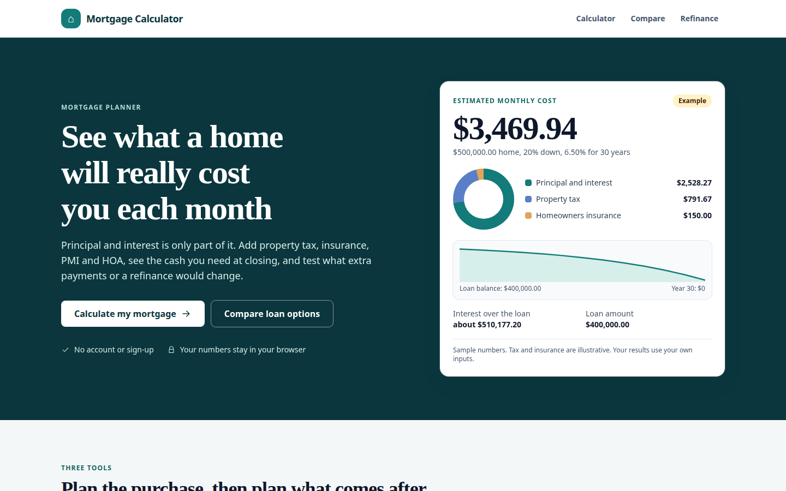

> **Status:** an assignment submission for KnowledgeCity's Technology Division (AI-assisted Calculator Web App). Results are **estimates for planning**. They are not a loan offer, a lender quote or financial advice. See [Financial assumptions and limitations](#financial-assumptions-and-limitations).

## Why a mortgage calculator

A basic arithmetic calculator would have proved very little. A mortgage calculator is a better test of AI-assisted engineering because it needs:

- **Exact money math.** Money is stored as integer cents and rates as integer millionths, so rounding errors cannot build up over a 360-payment schedule.
- **Real product decisions.** Which costs belong in a "monthly payment"? What is paid to the lender and what is paid elsewhere? When does PMI end? What should happen when an input is invalid?
- **Honesty about uncertainty.** Property tax, insurance, PMI and future ARM rates are assumptions. The app labels every one of them as entered, illustrative or overridden.
- **Several connected tools** (purchase, comparison, refinance, extra payments) that share one calculation engine.

## Target audience

The product defines three roles (details in [docs/app-roles.md](docs/app-roles.md)). One product serves all three.

| Role                                    | Practical problem                                                                                   | How the app helps                                                                                                             |
| --------------------------------------- | --------------------------------------------------------------------------------------------------- | ----------------------------------------------------------------------------------------------------------------------------- |
| **First-time buyer**                    | Does not know the real monthly cost or the cash needed at closing. Free tools often show only P&I.  | One itemized monthly total (lender payment vs. paid elsewhere), PMI, cash to close, and a simplified affordability check.     |
| **Existing homeowner**                  | Wonders whether extra payments or a refinance are worth it, and how long it takes to recover costs. | Extra-payment simulation (payoff month, interest saved), refinance break-even, and rate sensitivity.                          |
| **Mortgage / real-estate professional** | Needs to show tradeoffs to a client and hand over a report.                                         | Side-by-side loan comparison (fixed vs. fixed, or fixed vs. ARM), saved scenarios and a printable report with the disclaimer. |

## Key features

Every feature below was checked in the running app (see [Testing and verification](#testing-and-verification) and the Verification section of [docs/user-stories.md](docs/user-stories.md)).

- **Purchase inputs.** Home price, down payment as percent or dollars (the two stay in sync), interest rate, and 15, 20 or 30 year terms. Shows loan amount and loan-to-value.
- **Fixed-rate principal and interest**, with the lifetime interest total.
- **5/6 adjustable-rate mortgage (ARM).** Margin, caps and floor, with a true payment recalculation at each reset from the current balance and remaining months. Three assumed index paths (flat, +1 point per year, shock). Rows after the fixed period are labelled **"Hypothetical rate"**.
- **Monthly ownership estimate.** Principal and interest, property tax, homeowners insurance, extra insurance, HOA and other costs, split into _lender payment (escrow)_ and _non-escrow_.
- **Property tax by state.** An illustrative demo rate for a small set of states, with a manual override.
- **PMI.** Estimated when the down payment is under 20%, with the first month you can request removal (80% of the home price) and the month it ends (78%).
- **Closing costs and cash to close.**
- **Simplified affordability.** Front-end and back-end debt-to-income ratios against editable guideline limits (default 28% and 36%), always with a "not a loan approval" statement.
- **Amortization schedule.** Monthly or yearly view, plus a balance chart you can explore by year.
- **Extra payments.** A monthly extra amount or a one-time lump sum, with payoff month and interest saved.
- **Rate sensitivity.** Payment at five nearby rates.
- **Cost growth.** Yearly growth assumptions for property tax and insurance.
- **Assumptions panel.** Every default with its value, source, "as of" date and label, and a "May be out of date" flag after 365 days.
- **Loan comparison** (`/compare`). Two loans side by side, each with its own inputs, plus a "differences at a glance" summary. Swap loans, or copy Loan A to Loan B.
- **Refinance break-even** (`/refinance`). Monthly saving and months to break even. Shows "No monthly saving" instead of a misleading result.
- **Saved scenarios.** Saved in this browser's `localStorage` only, with open and delete (with confirmation). If storage is blocked, the app says so and keeps working.
- **Printable report.** Inputs, itemized estimate, schedule summary, assumptions with "as of" dates, and the disclaimer. Navigation and input controls are hidden when printing.
- **Input validation** with clear messages (for example "Down payment cannot be more than the price"), and a layout that works at 360 px wide.

## Screenshots

All screenshots are real captures of the running app with illustrative sample inputs (a $450,000 home, 20% down, 6.75% rate unless noted).

### Homepage and calculator

| Homepage (desktop, 1440 × 900)                                                              | Homepage (mobile, 390 × 844)                                                   |
| ------------------------------------------------------------------------------------------- | ------------------------------------------------------------------------------ |
|  | 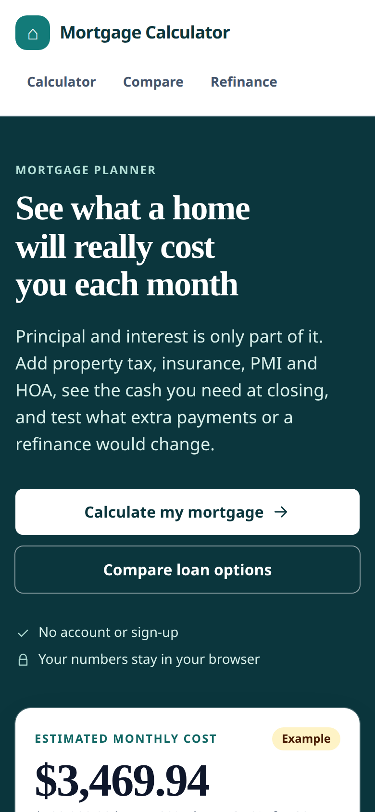 |

| Calculator (desktop, 1440 × 900)                                                                                               | Calculator (mobile, 390 × 844)                                                                               |
| ------------------------------------------------------------------------------------------------------------------------------ | ------------------------------------------------------------------------------------------------------------ |
| 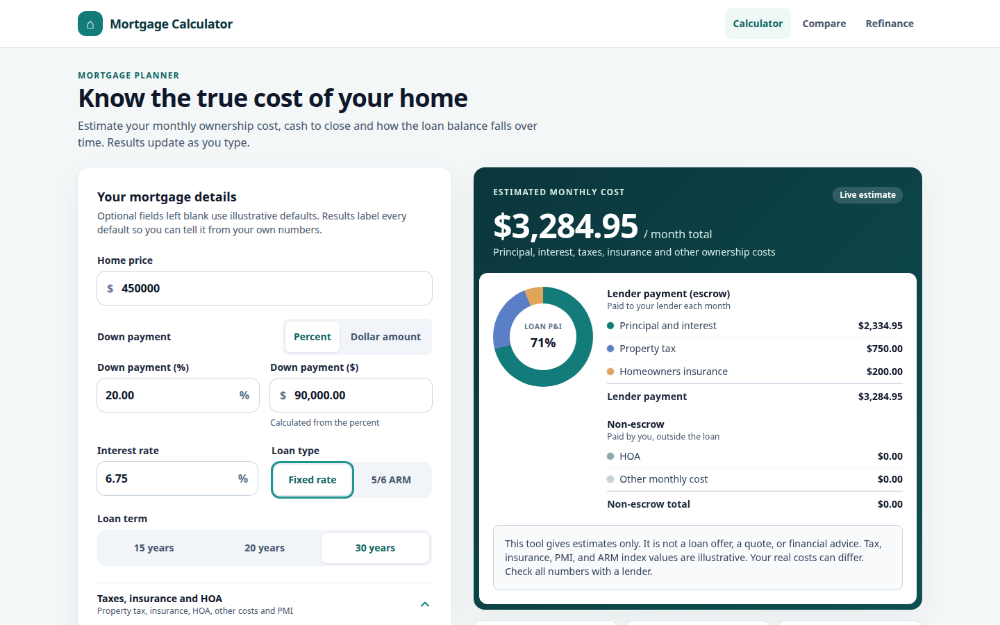 | 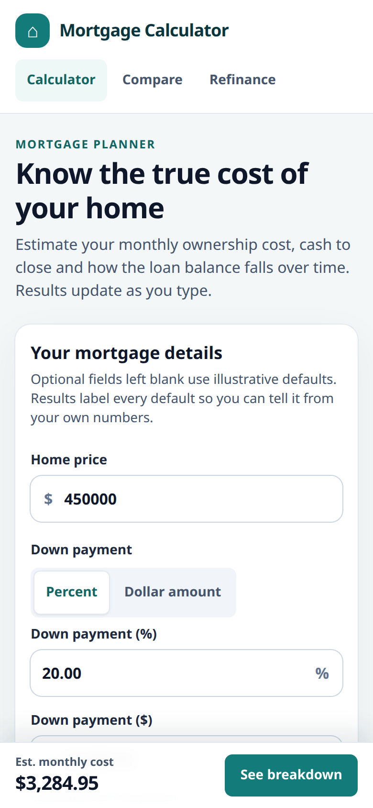 |

### Monthly ownership cost breakdown

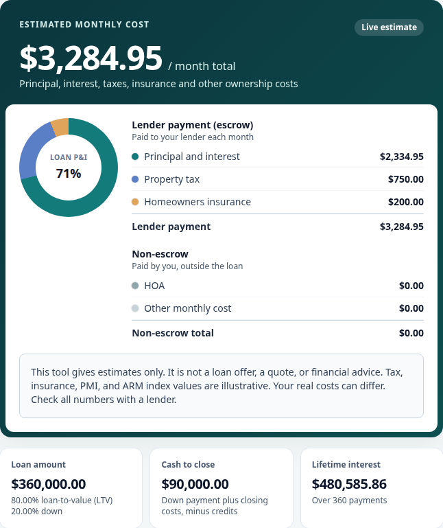

### Amortization schedule

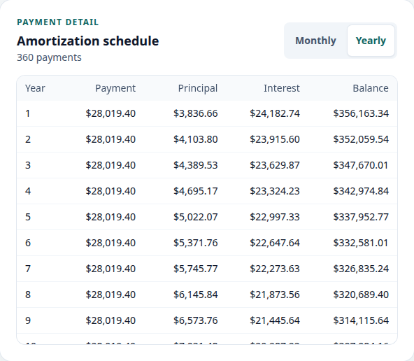

### Side-by-side loan comparison

A 15-year loan at 6.00% against a 30-year loan at 6.75% on the same $450,000 home.

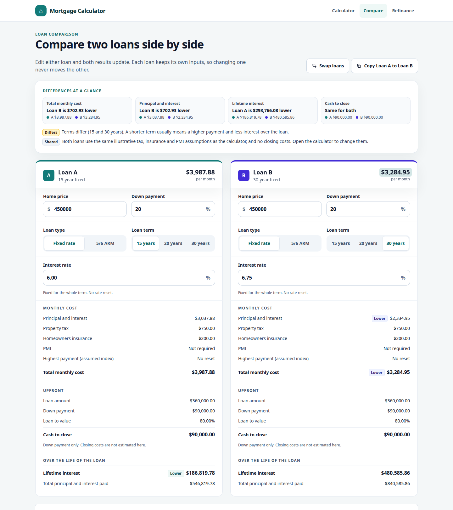

### Refinance break-even

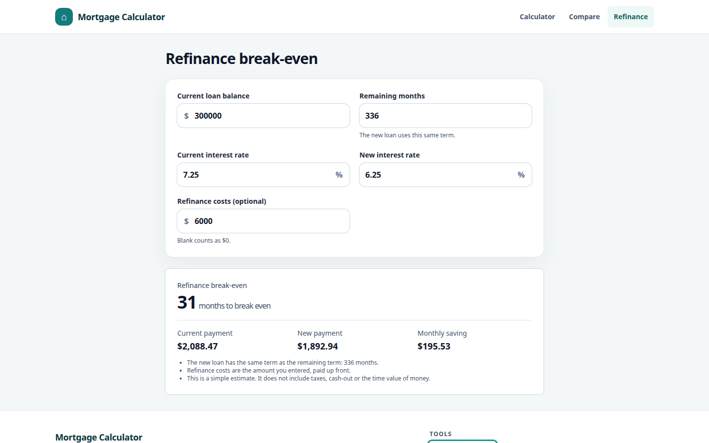

### 5/6 ARM and hypothetical rates

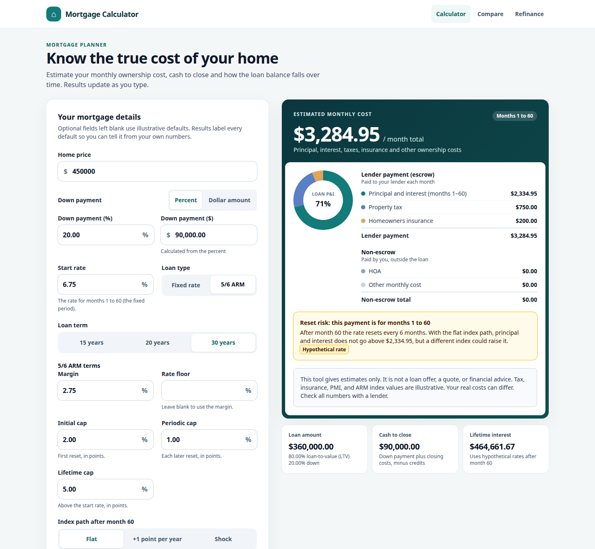

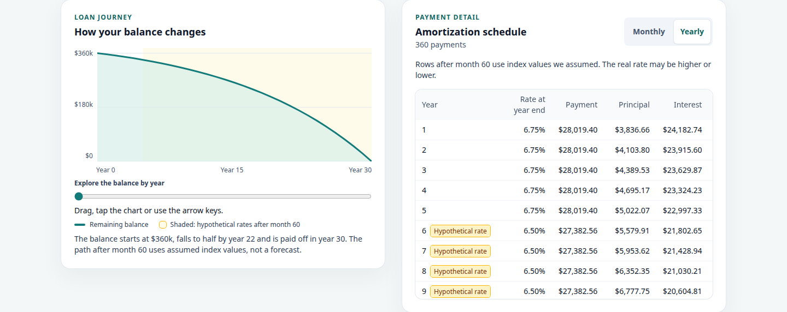

### Saved scenarios

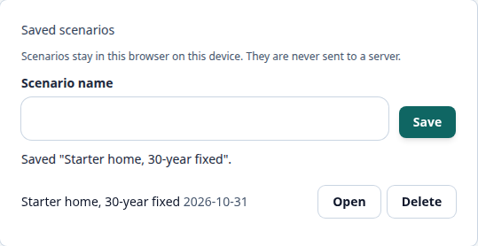

The mobile screenshots are captured at a 390 × 844 viewport with a 2× pixel ratio (780 × 1688 files). The desktop images that are not 900 px tall are full sections of the page.

## Technology stack

| Area        | Choice (exact version in `package.json`)      | Why                                                                                     |
| ----------- | --------------------------------------------- | --------------------------------------------------------------------------------------- |
| UI          | React 19.3.1                                  | Component model fits many small calculators that share logic.                           |
| Language    | TypeScript 7.0.2 (strict)                     | Branded `Cents` and `Micros` types stop money and rates being mixed up at compile time. |
| Build       | Vite 8.3.5                                    | Fast dev server, small production bundle, lazy-loaded pages.                            |
| Styling     | Tailwind CSS 4.3.3 (CSS-first config)         | Consistent design tokens, no unused CSS shipped.                                        |
| Routing     | React Router 8.5.1                            | Each page is its own lazy chunk.                                                        |
| Tests       | Vitest 5.0.5, Testing Library, jsdom          | Fast unit tests for the maths and component tests for behaviour.                        |
| Lint/format | Biome 2.6.4 (Prettier for Markdown/YAML only) | One fast tool, with custom rules that enforce the component style in CLAUDE.md.         |
| Packages    | Yarn 4 (Berry) via Corepack                   | Reproducible installs from `yarn.lock`.                                                 |
| Container   | Docker (`Dockerfile`, `docker-compose.yml`)   | Optional. Serves the built app with `serve`; no nginx.                                  |
| CI          | GitHub Actions                                | Runs check, typecheck, test and build on every pull request.                            |

There is **no backend, database, state library or third-party API**. State lives in `useState` / `useReducer` inside feature hooks.

## Getting started

You do **not** need a paid service, a cloud account, an API key, credentials or a hosted backend. No `.env` file is needed.

**Prerequisites**

- Node.js 22 or newer (`.nvmrc` pins 22).
- Git.
- Corepack (ships with Node) to provide Yarn 4. If `yarn` is not found, run `corepack enable`. If that is not permitted, use `corepack yarn` instead of `yarn` in the commands below.

**Run the app**

```bash
git clone https://github.com/wajidalii/mortgage-calculator.git
cd mortgage-calculator
corepack enable
yarn install
yarn dev
```

Open <http://localhost:5173>.

**Production build and local preview**

```bash
yarn build     # type-checks, then builds to dist/
yarn start     # builds, then serves dist/ with SPA fallback on http://localhost:3000
```

**With Docker (optional)**

```bash
docker compose --profile dev up --build    # dev server on http://localhost:5173
docker compose --profile prod up --build   # production build on http://localhost:3000
```

**Configuration.** Two optional variables exist, `VITE_APP_NAME` (default "Mortgage Calculator") and `VITE_API_BASE_URL` (default `/api`, currently unused because the app makes no network calls). See `.env.example`. Every `VITE_*` value is inlined into the public bundle, so never put secrets in them.

## Testing and verification

```bash
yarn test        # Vitest, single run
yarn typecheck   # tsc -b --noEmit
yarn check       # Biome lint + format + import order
yarn build       # tsc -b && vite build
```

Result of the most recent run, from a fresh clone-style copy with `yarn install --immutable` and **no `.env`**: **39 test files, 460 tests, all passing**. `yarn typecheck`, `yarn check` and `yarn build` also passed.

The major suites cover:

- **Money and rate arithmetic** (`lib/money`, `lib/rate`, `lib/payment`): integer cents and millionths, rounding, parsing and formatting, including negative amounts and malformed thousands separators.
- **Amortization** (`lib/amortization`, plus a randomized reference-ledger test): principal repaid equals the loan, final balance is exactly $0, yearly rows equal the sum of their months.
- **ARM** (`lib/arm`, `armSchedule`): reset payments from the current balance, caps and floor, and the "Hypothetical rate" label.
- **Product rules:** property tax, PMI and its end months, closing costs, affordability, extra payments, cost growth, rate sensitivity, refinance, comparison and defaults.
- **Error handling and boundaries:** validation messages, 0% rate, 100% down payment, rates above 30% or below 0%, text in money fields, and storage that is blocked.
- **UI behaviour:** calculator, assumptions panel, saved scenarios, compare, refinance and homepage components.
- **Privacy guard** (`services/networkGuard.test.ts`): fails if any code outside `src/services/` can reach the network, or if `index.html` loads anything from another origin.

The acceptance criteria in [docs/user-stories.md](docs/user-stories.md) were also checked by hand-driven browser automation against the running app. The same sample values appear in the tests.

## Financial assumptions and limitations

- **Estimates only.** Results are for planning. They are not a loan offer, a lender quote, a pre-approval or financial advice. The app shows this disclaimer on every result and every printed page.
- **Property tax** uses an **illustrative flat demo rate** for each of a few states, applied to the home price. Real tax depends on county, assessed value and exemptions. You can override it. The demo rates have not yet been checked against a primary source (open issue #29).
- **Homeowners insurance** defaults to an illustrative national average ($2,400 a year). Flood, wind and similar cover is not added automatically. Enter it yourself.
- **PMI** uses an illustrative annual rate on the original loan amount. It is modelled to end at 78% of the home price, and removal can be requested at 80%. Real PMI depends on credit score, loan program and insurer (default not yet replaced with a current insurer figure, issue #27).
- **ARM.** Only a 5/6 ARM is modelled. After the fixed period the rate follows an **assumed** index path (flat, +1 point per year or shock) plus margin, within the caps and floor you enter. These are what-if scenarios, not forecasts, and every such row is labelled "Hypothetical rate". The default margin and caps have not yet been checked against a current Loan Estimate (issue #28).
- **Affordability** is a simplified debt-to-income check against guideline limits. Lenders also look at credit, assets, reserves, loan program rules and more.
- **Refinance** assumes the new loan has the same term as the remaining term and that the costs you enter are paid up front. It ignores taxes, cash-out and the time value of money.
- **Out of scope:** ZIP or address tax lookup, transfer and recording taxes, agent and lender fee estimates, FHA, VA and jumbo rules, user accounts and server storage.

This project makes no claim of regulatory, lender or financial certification.

## AI-assisted development

This project was built with **Claude Code** (Anthropic's CLI coding agent). Details below come from the session exports in [`transcripts/`](transcripts/) and the repository history.

- **Tool and model.** Each of the nine exported sessions opens with the header `Claude Code v2.1.314 · Sonnet 5.5`, so **Sonnet 5.5** was the model for all recorded sessions. The planning session recommended switching to Opus 5.5 for orchestration, but the exports do not show a model switch.
- **Requirements.** Session 01 is a product-management dialogue where Claude acted as a critical product partner and asked one question at a time. It led to the PRD, roles, jobs and user stories.
- **Architecture.** Session 02 produced the stack decisions, project layout, lint rules, Docker setup and the feature roadmap (`PLAN.md`), plus a dependency vulnerability check.
- **Implementation.** Later sessions built the calculation engine and features issue by issue, each on its own branch and pull request, then redesigned the calculator, homepage and compare pages and added motion.
- **Review and testing.** Features were written with tests, and accessibility, performance and privacy audits were run and recorded in `ACCESSIBILITY.md`, `PERFORMANCE.md` and the network-guard test.
- **Product owner direction.** The repository owner set the goals, answered the product questions, approved decisions and design directions, and merged every pull request (all 40 merged PRs were merged by the owner's GitHub account).
- **Manual code changes.** The session exports do not record whether the owner edited any source file by hand, so this README does not claim either way. Git history shows the commits under the owner's git identity (three commits are authored under the name "Claude").

## Product documentation

The three required documents, in order:

1. [App Roles](docs/app-roles.md) (AR-1 to AR-3)
2. [Jobs To Be Done](docs/jobs-to-be-done.md) (J-1 to J-4)
3. [User Stories with Acceptance Criteria](docs/user-stories.md) (S-1 to S-19, each with a status of Implemented or Not implemented)

Roles, jobs and stories are linked by ID, so each story traces to a job and a role. Wider context: [PRD.md](PRD.md) (scope, rules, test plan), [PLAN.md](PLAN.md) (architecture and roadmap).

## AI session transcripts

Complete, unmodified Claude Code session exports, in order, are in [`transcripts/`](transcripts/): `session-01.md` to `session-09.md`. They run from the first prompt (product discovery) to the Compare Loans redesign (PR #85).

## Project structure

```
src/
  app/            router and providers
  layouts/        main layout (header + page outlet)
  pages/          one lazy-loaded page per route
  features/
    calculator/   inputs, results, ARM, PMI, tax, schedule, assumptions
    compare/      side-by-side loan comparison
    refinance/    break-even calculator
    scenarios/    saved scenarios (localStorage)
    home/         landing page sections
  components/     shared UI, layout and feedback (Disclaimer, ErrorBoundary)
  lib/            pure helpers: money (cents), rate (micros), payment, amortization, ARM
  config/         env defaults, defaults registry, state tax table, disclaimer text
  services/       the only place network code may live (currently unused)
docs/             product documents and design screenshots
transcripts/      full AI session exports
design/           static HTML design reference (not app code)
```

Other root files: `CLAUDE.md` (engineering rules), `PRD.md`, `PLAN.md`, `ACCESSIBILITY.md`, `PERFORMANCE.md`, `MOTION.md`.

## Future improvements

Not implemented yet:

- Verify the five demo state tax rates, the PMI default and the ARM margin and caps against primary sources (issues #29, #27, #28).
- More states and county-level tax lookup.
- Other loan types (FHA, VA, jumbo) and other ARM structures.
- Estimated closing costs and transfer taxes (today the user enters them).
- Decide the business model and success metric (issue #30).
- Exporting a report to PDF or file (today the report is printed from the browser).

## License and contact

No license file has been added to this repository, so no open-source license is granted. Questions about the project can go through the [GitHub repository](https://github.com/wajidalii/mortgage-calculator).
